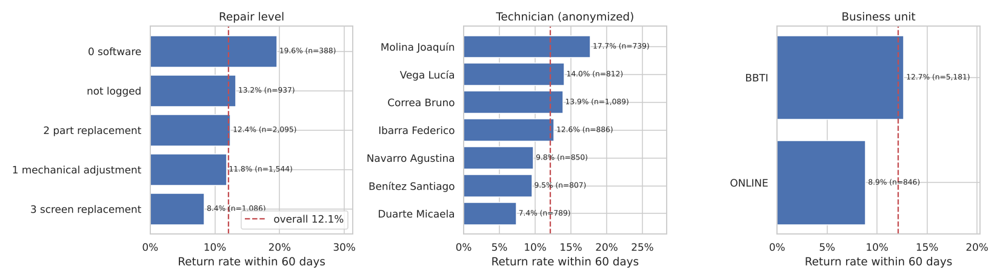
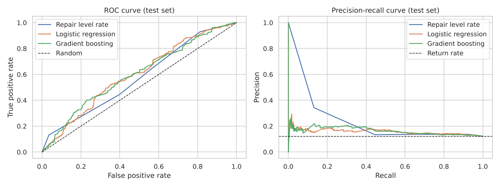

# 🔁 Which repaired phones come back?


> A machine learning project on **real (anonymized) operations data** from a phone repair lab: can we tell, at the moment of the repair, which devices will come back to a repair bench within 60 days?

📓 **Notebook:** [`notebooks/repair_returns.ipynb`](notebooks/repair_returns.ipynb)



## 📌 Key findings

- About **1 in 8 repaired phones comes back** within 60 days; 3 out of 4 returns happen in the first two weeks.
- **Software-only fixes come back the most** (~20%) and **screen replacements the least** (~8%). A quick software fix may hide a hardware problem.
- Notes about **unlocks** or "repaired, all functions OK" (no physical fix described) are linked to more returns.
- The models reach a **ROC-AUC of about 0.6**: a real but modest signal, and only slightly better than a one-line rule based on the repair level. Checking the 20% riskiest repairs finds about **a third of all returns** (1.6× the average rate).

## 🧪 Approach

| Step | What I did |
|---|---|
| Data cleaning | Read one hand-filled sheet per technician, matched columns by name, normalized text and dates, linked visits of the same device by IMEI ([`data/build_dataset.py`](data/build_dataset.py)) |
| Target | `returned_60d`: the device is logged again at a repair bench 1–60 days after being repaired |
| Leakage control | Dropped repairs from the last 60 days (they had no time to come back), ignored same-day duplicates, used only features known at repair time |
| Validation | **Time-based split**: train Nov 2025 – May 2026, test Jun – Aug 2026 |
| Models | Baselines, logistic regression with one-hot + **TF-IDF on free-text notes**, gradient boosting (HistGradientBoosting) |
| Metrics | ROC-AUC, PR-AUC (imbalanced target, ~12% positives) and lift of the riskiest repairs |

## 📊 Results (test set)

| Model | ROC-AUC | PR-AUC |
|---|---|---|
| Baseline (no model) | 0.500 | 0.122 |
| Return rate of the repair level | 0.574 | 0.162 |
| Logistic regression | 0.597 | 0.160 |
| Gradient boosting | 0.599 | 0.166 |



## 🗂️ Data

`data/repairs.csv` has **24,404 visits** to a repair bench (Nov 2025 – Oct 2026). Technician names and device identifiers are **fake**, and IMEIs were replaced with a numeric `device_id`. The source workbook (also anonymized) and the Power BI dashboard built on it are in [powerbi-laboratorio-celulares](https://github.com/RamaDiBer/powerbi-laboratorio-celulares).

*Notes, statuses and business-unit codes are in Spanish, as logged by the technicians.*

## ▶️ How to run it

```bash
pip install -r requirements.txt
jupyter notebook notebooks/repair_returns.ipynb
```

To rebuild the CSV from the workbook: `python data/build_dataset.py path/to/laboratorio_demo.xlsx`.
